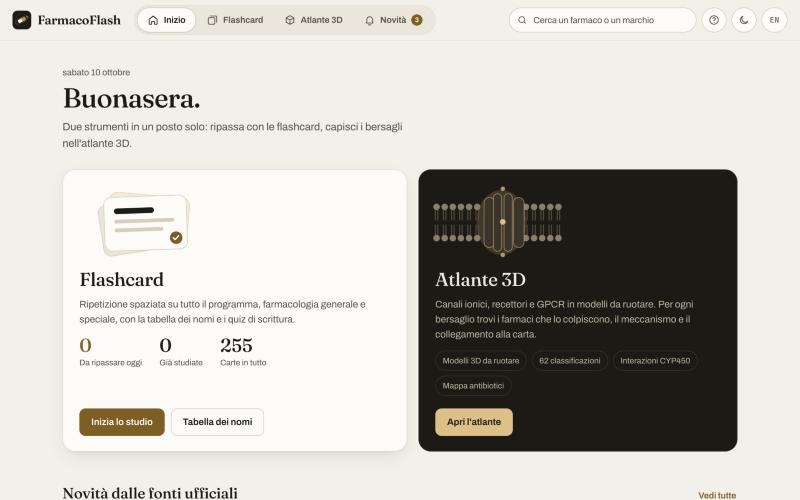

<div align="center">

# FarmacoFlash
### Farmacologia per l'esame: flashcard + atlante 3D

**Apri l'app: [mutablewarp.github.io/farmacoflash](https://mutablewarp.github.io/farmacoflash/)**

🇮🇹 **Italiano** · 🇬🇧 [English](README.en.md)


-2f7d5f?style=flat-square)


</div>

<p align="center">
  
</p>

## Cosa trovi

| | Sezione | A cosa serve |
|:--:|---|---|
| 📇 | **Flashcard** | Carte a ripetizione spaziata su tutto il programma (farmacologia generale e speciale), ognuna con un approfondimento verificato. Dentro: **Oggi**, **Studia**, **Sfoglia**, **Tabella dei nomi** con quiz di scrittura, **Progressi**. |
| 🧬 | **Atlante 3D** | Canali ionici, recettori e GPCR in modelli da ruotare; per ogni bersaglio i farmaci, il meccanismo, le 62 classificazioni d'esame e il collegamento alla carta. |
| 🔔 | **Novità** | Ogni notte: avvisi di sicurezza (EMA, AIFA, FDA) e nuove linee guida (PubMed). Le carte interessate mostrano un avviso con il link alla fonte; il contenuto si corregge solo dopo verifica. |

Dalla schermata **Inizio** vedi le carte da ripassare oggi, il programma per moduli e le ultime novità.
Il pulsante **?** apre un **giro guidato** che ti mostra, sui pulsanti veri, dove sta ogni cosa.

## Come iniziare

1. Apri il link qui sopra (computer o telefono).
2. Fai il giro guidato (un minuto).
3. **Flashcard → Studia**: leggi il farmaco, rispondi a mente, gira la carta, valuta quanto ricordavi.

**Installala sul telefono:** iPhone → Safari → Condividi → *Aggiungi alla schermata Home*. Android → Chrome → ⋮ → *Installa app*.
Dopo la prima apertura funziona anche senza connessione.

## Privacy
I progressi restano **solo nel tuo browser**: nessun account, nessun server. Per cambiare dispositivo usa
**Progressi → Esporta backup** e poi *Importa* sull'altro.

## Sviluppo
```bash
npm run build   # rigenera flashcard, tabella e programma
npm test        # controlli su dati, sintassi, build e feed
npm start       # anteprima locale su http://127.0.0.1:8765
```
Regole, struttura e flusso di lavoro: [CLAUDE.md](CLAUDE.md). Ogni push su `main` pubblica il sito da solo.

## Note
Materiale **per lo studio personale**: gli approfondimenti sintetizzano *Goodman & Gilman, 14ª ed.* e letteratura
PubMed e **non** sostituiscono il libro né il giudizio clinico.

<div align="center"><sub>Strumento di studio · non è supporto decisionale clinico</sub></div>
