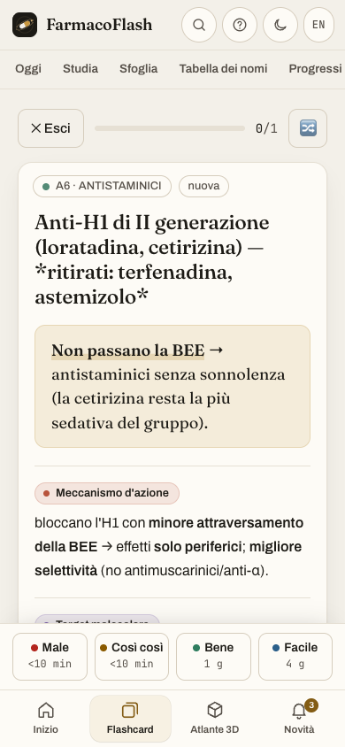
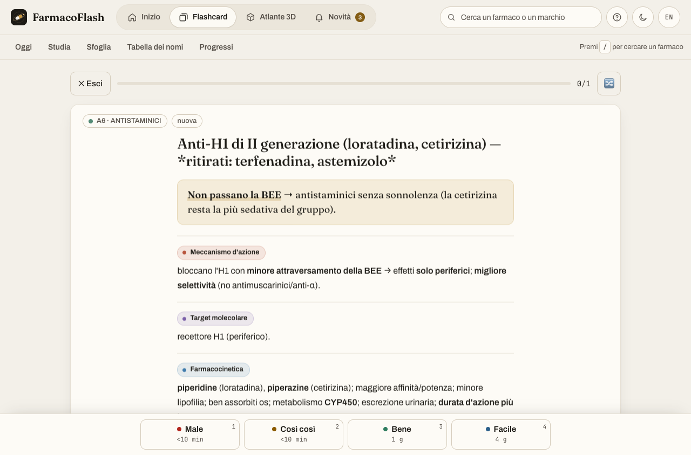

# FarmacoFlash in pochi minuti

Questa guida riguarda la nuova versione locale. Il sito online non è ancora stato aggiornato.

1. **Oggi** — scegli quante carte nuove affrontare. Puoi studiare solo nuove, solo ripasso oppure entrambe.
2. **Cerca** — scrivi il nome del farmaco. Seleziona un argomento per restringere l'elenco. “A→Z” aiuta a ripassare i nomi. L'elenco è quello delle schede di studio, non ancora tutto il registro AIFA.
3. **Studia** — prova a rispondere senza guardare. Mostra la risposta e valuta sinceramente ciò che ricordi. Puoi scorrere fino all'ultima riga; i pulsanti restano in basso.
4. **Scrivi i nomi**, nella tabella — digita il nome richiesto. Dopo un errore, riscrivilo correttamente. L'errore iniziale resta nello storico: correggersi non cancella ciò che serve ripassare. “Studia questa scheda” apre la spiegazione; **Cerca** riporta al quiz lasciato aperto.
5. **Esplora** — scegli un bersaglio e leggi come funziona. Il modello è uno schema didattico. Se il 3D non si carica, puoi ancora leggere i contenuti e consultare le animazioni 2D.
6. **Progressi** — guarda cosa ripassare ed esporta regolarmente un backup. Conserva il file in un posto sicuro. Per trasferire i risultati su un altro dispositivo devi importarlo: non c'è sincronizzazione automatica.

Il pulsante **Guida** riapre il tutorial. **Scuro/Chiaro** cambia tema; **EN/IT** cambia lingua nelle parti già tradotte. La tabella è ancora principalmente in italiano.

## Un ritmo semplice

Ripassa prima gli errori, poi aggiungi nuove carte. Quando sbagli un nome, leggilo, coprilo e riscrivilo. Dopo una spiegazione, prova a dire a voce “bersaglio → effetto → motivo della reazione avversa”. Non considerare un punto nel quiz una prova di padronanza clinica.

## Se compare un problema di salvataggio

Non chiudere subito la pagina. Vai in Progressi ed esporta un backup. Non cancellare i dati del browser. Un backup non valido viene rifiutato; prima di un'importazione valida l'app conserva una copia dello stato precedente sullo stesso browser.

## Schermate reali della revisione

Materiale di studio, non indicazione terapeutica. Lo stato completo e ciò che manca sono in [STATUS.md](STATUS.md).
